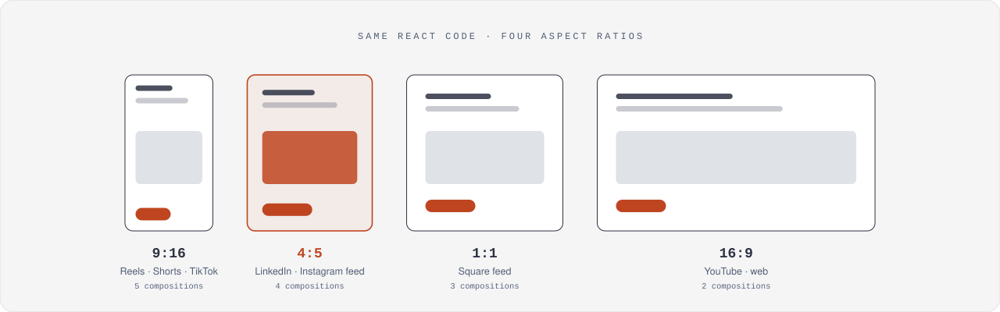

<p align="center">
  
</p>

<p align="center">
  <a href="https://www.remotion.dev"></a>
  <a href="https://react.dev"></a>
  <a href="https://www.typescriptlang.org"></a>
  <a href="https://threejs.org"></a>
  
  <a href="LICENSE"></a>
</p>

<p align="center">
  <b>Short-form product videos built with React.</b><br>
  Write the narration as JSON, generate the voice and the soundtrack locally, preview in Remotion Studio and render every feed format with one command.
</p>

---

## Why

Recording a voiceover, finding royalty-free music and re-exporting each ad for Reels, LinkedIn and YouTube takes longer than building the video itself. This repo moves all of that into code:

- **Offline neural voiceover.** [sherpa-onnx](https://github.com/k2-fsa/sherpa-onnx) runs Piper VITS voices on the CPU. No API key, no cloud and no per-character billing.
- **Procedural soundtrack.** `score.mjs` synthesizes a seeded track that builds up to the reveal and hits on every scene cut, so the music always fits the edit.
- **Automatic ducking.** `<Soundtrack>` reads the voice manifest and lowers the music while someone is speaking.
- **One composition, every format.** Each ad is registered at several aspect ratios from the same React code.
- **Reproducible.** The same JSON produces the same audio and the same frames every time.

## How it works

<p align="center">
  .json feeds the neural voiceover and the procedural score; both write WAV files to public/, which the Remotion compositions mix and render to out/*.mp4" width="100%">
</p>

1. **`voiceover/<name>.json`** holds the script: voice, speed, timed lines, and a `score` block with duration, transposition, cut times and reveal moment.
2. **`npm run voice -- <name>`** synthesizes each line to `public/voiceover/<name>/*.wav` and writes a `manifest.json` with the measured durations.
3. **`npm run score -- <name>`** renders `public/music/<name>.wav`, timed to the same cuts.
4. **Compositions** load both through `staticFile()`, place each line at its `at` time and duck the music around it.
5. **`npx remotion render <id>`** writes the final MP4 to `out/`.

## Formats

<p align="center">
  
</p>

| Composition | Size | What it is |
|---|---|---|
| `MChiodiPromo` | 1080×1920 | 30-second kinetic-typography promo, 23 scenes |
| `FitForgeAd` · `FitForgeAdSquare` · `FitForgeAdWide` | 9:16 · 1:1 · 16:9 | App-store style ad for the FitForge fitness app |
| `PortfolioStory` · `PortfolioStoryVertical` | 16:9 · 9:16 | Voxel 3D career story built with `@remotion/three` |
| `EditorMchiodiLinkedIn` | 1080×1350 | Ad for Editor MChiodi, an AI video editor |
| `CockpitLinkedIn` · `CockpitSquare` | 4:5 · 1:1 | Ad for Cockpit, a status panel for Claude Code |
| `PrompterAd` · `PrompterAdVertical` | 4:5 · 9:16 | Ad for Prompter MChiodi, a voice-driven teleprompter |
| `FlintpadLinkedIn` · `FlintpadSquare` | 4:5 · 1:1 | Ad for Flintpad, an all-in-one dev workspace |
| `VoiceoverDemo` | 1080×1920 | Minimal example of the voiceover pipeline |

All compositions run at 30 fps.

## Quick start

Requirements: **Node.js 20+**, **FFmpeg** on your `PATH`, and `tar` with bzip2 support (built into Windows 10+, macOS and Linux).

```bash
# 1. Install dependencies
npm i --loglevel=error

# 2. Download a voice once (faber is the default; cadu and jeff are also available)
npm run tts:setup -- faber

# 3. Generate the audio for an ad
npm run voice -- flintpad
npm run score -- flintpad

# 4. Preview in Remotion Studio
npm run dev

# 5. Render
npx remotion render FlintpadLinkedIn out/flintpad-linkedin.mp4
```

> Generated audio (`public/voiceover/`, `public/music/`) and the voice models (`.tts-models/`, ~230 MB) are git-ignored. Run steps 2 and 3 after cloning.

## Scripts

| Command | What it does |
|---|---|
| `npm run dev` | Opens Remotion Studio with live preview |
| `npm run build` | Bundles the project for server-side rendering |
| `npm run tts:setup -- <voice>` | Downloads a pt-BR Piper voice into `.tts-models/` |
| `npm run voice -- <name>` | `voiceover/<name>.json` → WAV lines + `manifest.json` |
| `npm run score -- <name>` | `voiceover/<name>.json` → `public/music/<name>.wav` |
| `npm run lint` | ESLint + `tsc` |
| `npm run upgrade` | Upgrades every Remotion package together |

## Writing a script

```jsonc
{
  "voice": "faber",          // installed Piper voice
  "speed": 1,                // speaking rate
  "lines": [
    { "id": "01-hook",   "at": 0.4, "text": "How many apps do you open just to get work done?" },
    { "id": "02-reveal", "at": 6.7, "text": "Meet Flintpad." }
  ],
  "score": {
    "duration": 37.6,        // seconds, matches the composition
    "transpose": 5,          // semitones
    "cuts": [3.1, 10.3, 21.9, 27, 30.6],
    "reveal": 6.7,           // the track builds up to this moment
    "pulseFrom": 6.7
  }
}
```

The bundled voices are Brazilian Portuguese. To use another language, point `tts-setup.mjs` and `voiceover.mjs` at any other [Piper model from the sherpa-onnx releases](https://github.com/k2-fsa/sherpa-onnx/releases/tag/tts-models).

## Project structure

```
├── voiceover/            # narration + score scripts (one JSON per video)
├── scripts/
│   ├── tts-setup.mjs     # downloads Piper voices
│   ├── voiceover.mjs     # offline TTS → WAV + manifest
│   └── score.mjs         # procedural soundtrack synth
├── public/               # images, logos, generated audio
├── src/
│   ├── Root.tsx          # registers every composition
│   ├── Soundtrack.tsx    # voice + music with ducking
│   ├── <Name>Ad/         # one folder per ad: scenes, theme, register.tsx
│   └── voxel-story/      # 3D voxel scenes (@remotion/three)
└── docs/assets/          # README illustrations
```

## Adding a new video

1. Create `src/MyAd/` with the scenes and a `register.tsx` that maps your formats to `<Composition>`.
2. Add it to `src/Root.tsx`.
3. Write `voiceover/my-ad.json`, then run `npm run voice -- my-ad` and `npm run score -- my-ad`.
4. Drop `<Soundtrack name="my-ad" />` into the composition.

## License

[MIT](LICENSE) © Matheus Chiodi.

Brand names, logos and screenshots of the advertised products (FitForge, Flintpad, Cockpit, Prompter MChiodi, Editor MChiodi) are not covered by the MIT license — reuse the code, not the brands.

Remotion is free for individuals and small teams, but some companies need a [company license](https://www.remotion.dev/license). Piper voices are distributed under their own model licenses.
